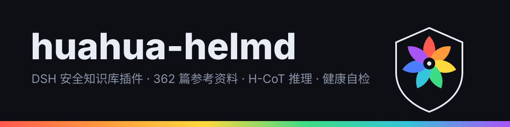

<div align="center">




# huahua-helmd

**DSH 宿主插件：随身安全知识库 + H-CoT 推理设置 + 健康自检**

362 篇按域分类的实战参考资料 · 9 大安全域 · 装上即成为模型的领域知识底座

[](LICENSE)
[](#%E7%8E%AF%E5%A2%83%E8%A6%81%E6%B1%82)
[](#%E7%9F%A5%E8%AF%86%E5%BA%93)

</div>

---

## 这是什么

`huahua-helmd` 是 **DeepSeek Harness（DSH）宿主**的一个 bundle 插件，把一整套**安全领域知识库**变成模型的随手可查资料，并额外提供两个实用件：**H-CoT 推理设置页** 与 **宿主健康自检**。

和「技能」的区别：

| | 技能（skill） | 本插件的知识库（references） |
|---|---|---|
| 形态 | 带触发条件的操作手册 | 按域分类的参考资料 |
| 谁读 | 模型在匹配到场景时主动加载 | 模型按需检索，像翻手册 |
| 例子 | 「用 nuclei 扫一遍」 | 「SQL 注入 46 KB 全量手法 + 判定 + 绕过」 |

## 三大能力

### 一、知识库（`references/` · 362 篇）

| 域 | 内容举例 |
|---|---|
| `web` | SQL 注入、命令注入、SSTI、文件上传、路径穿越/LFI、业务逻辑漏洞、webshell 管理 |
| `protocol` | 反弹 shell 技术族、未授权访问服务矩阵、常见端口服务速查 |
| `android` | 移动端逆向与攻击面 |
| `native` | 二进制与内存安全 |
| `malware` | 恶意样本分析方法与家族特征 |
| `ai-security` | 提示注入、模型越界、智能体安全 |
| `evidence` | 取证与证据链规范 |
| `toolbox` | 工具使用速查 |

### 二、H-CoT 设置（`helmd-hcot-settings`）

独立的设置命名空间 + 前端数据面，用于配置推理链（H-CoT）相关参数。单独一行注册，不与主行共享 apply，避免其中一个注册遮蔽另一个。

### 三、健康自检（`helmd-health`）

插件主入口即健康检查：装完后可确认 patch 是否全部 apply、依赖是否齐全、预设是否生成。

## 环境要求

```
DSH  ≥ 0.2.1-rc.2
Node ≥ 20
peer: @deepseek-ai/cordis ^4.0.2 · dsh-settings · dsh-tools · schemastery
```

## 安装

```bash
# 从 GitHub
dsh plugin --profile desktop add "github:azure5100/huahua-helmd"

# 或从本地 tarball
dsh plugin --profile desktop add "file:D:/path/to/huahua-helmd-0.4.3.tgz"

# 装完重启宿主（bundle 插件必须重启）
```

装完验证：

```bash
# 1) bundles 里有 huahua-helmd
# 2) node_modules/huahua-helmd/cordis.patch.yml 存在
# 3) 设置里能看到 H-CoT 面板
# 4) 宿主控制台无 patch apply 报错
```

## 目录结构

```
huahua-helmd/
├── dist/                      构建产物（health / index / hcot-settings / hcot-engine）
├── client.js                  浏览器侧界面
├── references/                362 篇知识库（9 个域）
├── presets/                   agent 预设（helmd）
├── scripts/gen-preset.mjs     预设生成器
├── cordis.patch.yml           主 patch（health + hcot-settings 两行）
├── preset.generated.patch.yml 预设 patch（生成 helmd 预设）
└── assets/                    品牌资产
```

## ⚠️ 关于杀软告警

`references/` 下的文档里有**可执行的 payload 代码样例**（一句话木马、反弹 shell 一行命令等）。签名/ML 引擎会按 payload 家族命名，报成 `Backdoor:PHP/Chopper` / `Backdoor:PHP/Remoteshell` / `Trojan:Script/Wacatac.B!ml` 之类。

**这是文本特征命中，不是可执行后门**：

```
· 文件全部是 .md 纯文本，没有任何进程会执行它
· 判断方法：扩展名 + 本机有没有对应运行环境（php/asp 解释器、web 服务）
· 处理：给 references/ 加杀软排除（推荐）；或把 payload 换成占位符
```

## 来源与衍生

本仓库是 `@adwmc/helm-d` 0.4.3 的**衍生版**，由 huahua 重命名并补文档、补品牌资产。

> ⚠️ **上游未声明开源许可**。本仓库对 huahua 新增的文档与资产采用 MIT；上游代码部分的再分发请先取得上游授权。详见 [NOTICE.md](NOTICE.md)。

## 文档

- [中文说明（推荐）](README.zh-CN.md)
- [使用手册](docs/USAGE.zh-CN.md)
- [来源与衍生声明](NOTICE.md)

## 许可证

[MIT](LICENSE)（huahua 衍生部分）· 上游许可状态见 [NOTICE.md](NOTICE.md)

---

<div align="center">**huahua-helmd** · 七色光花盾标志为 huahua 品牌资产</div>
